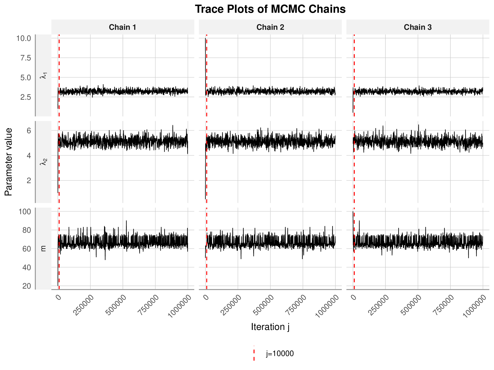
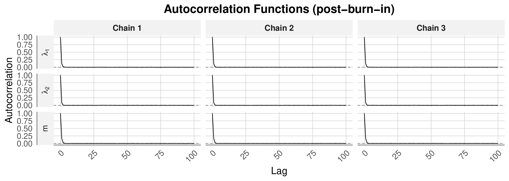

# Advanced Statistics for Physics Analysis

This repository contains a set of coursework assignments for the course Advanced Statistics for Physics Analysis, taught by Prof. Jacopo Pegoraro at the University of Padova during the academic year 2025-26. The material is organized as a collection of assignment folders, each containing R code and a corresponding PDF report.

## Overview

The project is an educational repository for Bayesian statistics and data analysis exercises. It is not intended as reusable software or as a production-ready package. The goal is to document the work done for the assignments, including exploratory analysis, statistical modeling, inference, diagnostics, and interpretation.


## Example plots
The following example plots (from assignment 2) show the Monte Carlo Markov chains (MCMC) trace diagnostics and autocorrelation structure for the Gibbs sampler used in the changepoint model.






## Assignment 0: warm-up and introductory statistical work

**Problem**: This assignment is a basic introduction to statistical analysis in R, including data handling, summaries, and exploratory plots.

**Method**: The work relies on standard R workflows, tidy data preparation, and simple statistical summaries and visualizations.

**Results**: The main outcomes are the exploratory analysis itself and the generated plots, which are reported in the corresponding PDF.

## Assignment 1: Poisson and negative binomial models

**Problem**: This assignment studies count data using Bayesian models and compares alternative likelihood choices.

**Method**: The solution uses Poisson and negative binomial models, conjugate prior reasoning, posterior summaries, and Bayesian model comparison ideas.

**Results**: The assignment provides posterior estimates, predictive checks, and a comparison between competing model formulations. Full details are in the PDF report.

## Assignment 2: changepoint Poisson model

**Problem**: This assignment models event counts with a possible change in the underlying Poisson rate over time.

**Method**: The analysis uses a Gibbs sampler and posterior summaries for the rate parameters and the changepoint location, together with diagnostics such as trace plots and autocorrelation checks.

**Results**: The project estimates the posterior distribution of the model parameters and the probability of a rate increase after the changepoint. The report contains the full interpretation.

## Assignment 3: Bayesian logistic regression with Stan

**Problem**: This assignment models a binary response as a function of a predictor, using Bayesian logistic regression.

**Method**: The implementation uses R with Stan via `cmdstanr`, with posterior sampling, credible intervals, diagnostics, and model comparison against an intercept-only model.

**Results**: The assignment provides posterior inferences for the regression coefficients and a comparison with the simpler model. Full interpretation is in the report.

## Files

```text
AdvancedStatistics2026/
├── assignment_0/
│   ├── assignment_0.R             # source code
│   └── assignment_0.pdf           # report (warmup assignment)
├── assignment_1/
│   ├── assignment_1.R             # source code
│   └── assignment_1.pdf           # report
├── assignment_2/
│   ├── assignment_2.R             # source code
│   └── assignment_2.pdf           # report
├── assignment_3/
│   ├── assignment_3.R             # source code
│   ├── assignment_3.pdf           # report
│   ├── bernoulli_model.stan       # STAN model
│   └── intercept_only_model.stan  # STAN model
├── plots/                         # example plots 
└── README.md
```

## Notes and limitations

- This repository is coursework material, not a polished or reusable software project. Datasets used are not included here.
- The scripts and PDFs are written in a learning context and reflect the setup and assumptions of the assignments.
- This README is intentionally qualitative. Full mathematical details, numerical results, interpretation, and plots are kept in the assignment PDFs.

## Declaration of AI use

AI generative tools were used for coding / theoretical assistance, plotting support, and debugging help during the development of this work. They were also used to draft this README. All code was checked and tested by the author.

